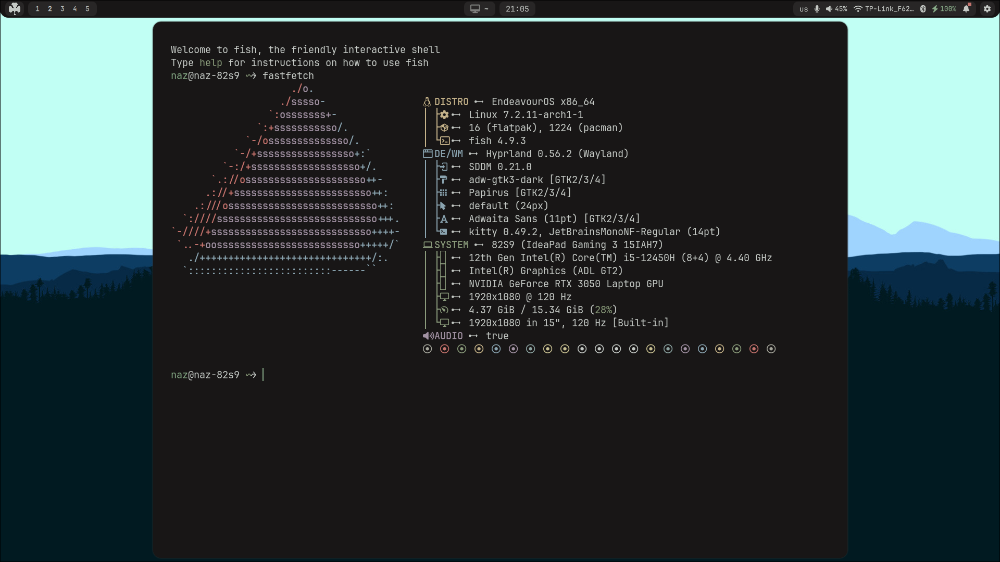
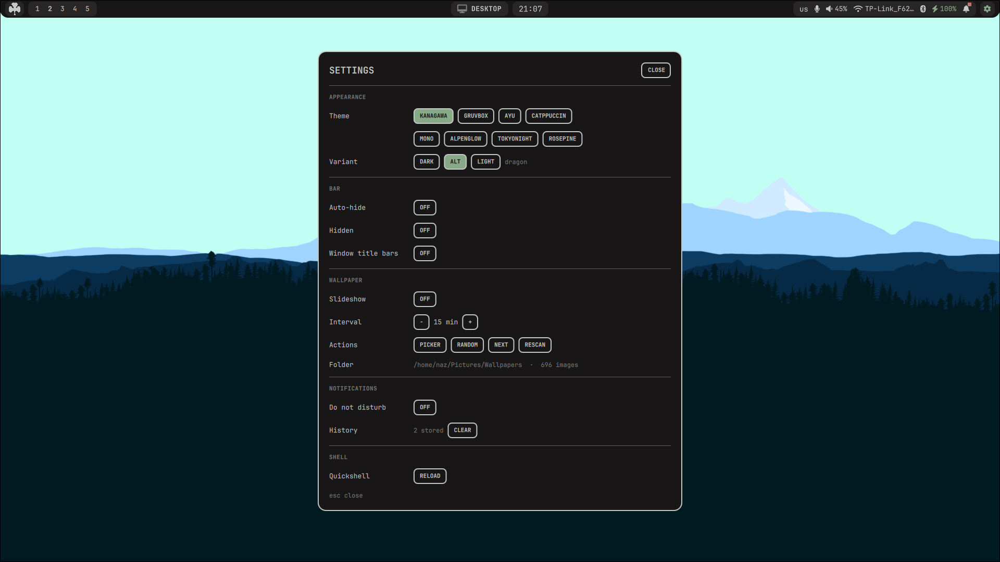

# 🍀 Clover

**A clean, themeable Hyprland + Quickshell rice**

Beautiful desktop experience on EndeavourOS / Arch with a custom Quickshell shell, multi-theme support, wallpaper management, and a polished settings UI.

<p align="center">
  
</p>

## ✨ Features

- **Quickshell-powered shell** — modern bar, notifications, control panels and settings
- **Multiple themes** with live switching:
  - Kanagawa · Gruvbox · Ayu · Catppuccin  
  - Mono · Alpenglow · Tokyonight · Rosepine
- **Variants**: Dark / Alt / Light (+ theme-specific accents)
- **Bar options**: Auto-hide, Hidden mode, Window title bars
- **Wallpaper system**: Slideshow, interval control, Picker / Random / Next / Rescan
- **Notifications** with Do Not Disturb + history
- **Quickshell reload** from the settings panel
- Clean top bar with workspaces, system tray, network, Bluetooth, battery, etc.

## 📸 Screenshots

### Settings Panel
<p align="center">
  
</p>

### Demo Video
https://github.com/user-attachments/assets/Video_2026-10-21_21-09-51.mp4

*(or open `assets/Video_2026-10-21_21-09-51.mp4` locally)*

## 🖥️ System Info (from the rice)

| Component          | Version / Details                          |
|--------------------|--------------------------------------------|
| Distro             | EndeavourOS x86_64                         |
| Kernel             | Linux 7.2.11-arch1-1                       |
| Shell              | fish 4.9.3                                 |
| DE/WM              | **Hyprland 0.56.2** (Wayland)              |
| Display Manager    | SDDM 0.21.0                                |
| Terminal           | Kitty 0.49.2                               |
| Font               | JetBrainsMono NF + Adwaita Sans            |
| GPU                | Intel ADL + NVIDIA RTX 3050 Laptop         |
| Wallpaper folder   | `~/Pictures/Wallpapers` (~700 images)      |

## 🎨 Themes

| Theme       | Style                  |
|-------------|------------------------|
| **Kanagawa**   | Japanese sumi-e inspired |
| **Gruvbox**    | Warm retro contrast     |
| **Ayu**        | Soft & modern           |
| **Catppuccin** | Pastel cozy             |
| **Mono**       | Minimal monochrome      |
| **Alpenglow**  | Soft mountain glow      |
| **Tokyonight** | Deep night blues        |
| **Rosepine**   | Elegant rose tones      |

Each theme supports **Dark / Alt / Light** variants (some themes have extra named variants like `dragon`, `hard`, `morning`, `dusk`, etc.).

## ⚙️ Settings Overview

The floating **SETTINGS** panel (opened from the bar or keybind) contains:

### Appearance
- Theme selector (8 themes)
- Variant (Dark / Alt / Light)

### Bar
- Auto-hide
- Hidden
- Window title bars

### Wallpaper
- Slideshow toggle
- Interval (default 15 min)
- Actions: Picker · Random · Next · Rescan
- Folder path + image count

### Notifications
- Do not disturb
- History clear

### Shell
- Quickshell **Reload** button

## 📦 Dependencies (recommended)

```bash
# Core
hyprland quickshell kitty fish sddm

## 🚀 Installation (high-level)

1. Clone this repository:
   ```bash
   git clone https://github.com/Nazeonix/Clover-shell.git ~/clover
   cd ~/clover
   ```

2. Copy configs (adjust paths as needed):
   ```bash
   cp -r ./* ~/.config/
   ```

3. Install dependencies (EndeavourOS / Arch):
   ```bash
   sudo pacman -S quickshell ttf-jetbrains-mono-nerd hyprland satty grim slurp xdg-desktop-portal-hyprland nwg-look papirus-icon-theme nautilus
   ```

4. Set wallpaper directory (default expected):
   ```bash
   mkdir -p ~/Pictures/Wallpapers
   # put your wallpapers here or anywhere
   ```

5. Launch Hyprland and enjoy. Use the settings panel to switch themes and wallpapers.

> **Note**: This is a personal rice. Paths, keybinds and some scripts may need small adjustments for your system.

## ⌨️ Keybinds

> From `binds.lua`

### Apps / Quick Actions

| Keybind              | Action                          |
|----------------------|---------------------------------|
| `Super` + `Return`   | Terminal (Kitty)                |
| `Super` + `Q`        | Close / quit window             |
| `Super` + `L`        | Lock screen                     |
| `Super` + `M`        | Power / exit                    |
| `Super` + `E`        | File manager (Nautilus)         |
| `Super` + `Space`    | App launcher                    |
| `Super` + `D`        | Dashboard                       |
| `Super` + `Escape`   | Power menu                      |
| `Super` + `P`        | Pseudo-tile                     |
| `Super` + `N`        | Wallpaper picker                |
| `Super` + `B`        | Theme toggle                    |
| `Super` + `I`        | Theme next                      |
| `Super` + `H`        | Toggle bar (auto-hide)          |
| `Alt` + `Tab`        | Window switcher (next)          |
| `Alt` + `Shift` + `Tab` | Window switcher (prev)       |

### Screenshot

| Keybind   | Action                                      |
|-----------|---------------------------------------------|
| `Print`   | Area select → annotate with satty           |

### Focus

| Keybind                | Action                |
|------------------------|-----------------------|
| `Super` + `←/→/↑/↓`    | Focus in direction    |
| `Super` + `.`          | Focus next column     |
| `Super` + `G`          | Fit visible columns   |

### Resize

| Keybind                     | Action                          |
|-----------------------------|---------------------------------|
| `Super` + `=` / `-`         | Column width ±0.1               |
| `Super` + `]` / `[`         | Cycle column presets            |
| `Super` + `\`               | Reset column to half            |
| `Super` + `Shift` + `=`/`-` | Window height ±20               |
| `Super` + `Ctrl` + arrows   | Fine resize (±0.05 / ±10)       |
| `Super` + `R`               | Enter resize mode               |

**Resize mode** (`Super` + `R`):
- `←/→` — column width
- `↑/↓` — window height
- `0` — reset to half
- `Esc` — exit

### Move Windows

| Keybind                  | Action                |
|--------------------------|-----------------------|
| `Super` + `Alt` + `←/→`  | Swap column left/right|
| `Super` + `Alt` + `↑/↓`  | Move window up/down   |

### Window Management

| Keybind          | Action              |
|------------------|---------------------|
| `Super` + `F`    | Toggle fullscreen   |
| `Super` + `V`    | Toggle floating     |

### Workspaces

| Keybind                    | Action                          |
|----------------------------|---------------------------------|
| `Super` + `1`–`0`          | Switch to workspace 1–10        |
| `Super` + `Shift` + `1`–`0`| Move window to workspace 1–10   |
| `Super` + `S`              | Toggle special workspace        |
| `Super` + `Shift` + `S`    | Move to special workspace       |
| `Super` + scroll           | Switch workspace                |

### Mouse

| Keybind               | Action          |
|-----------------------|-----------------|
| `Super` + `LMB`       | Drag window     |
| `Super` + `RMB`       | Resize window   |

### Multimedia

| Keybind                  | Action                |
|--------------------------|-----------------------|
| `XF86AudioRaiseVolume`   | Volume up             |
| `XF86AudioLowerVolume`   | Volume down           |
| `XF86AudioMute`          | Mute                  |
| `XF86AudioMicMute`       | Mic mute              |
| `XF86MonBrightnessUp`    | Brightness up         |
| `XF86MonBrightnessDown`  | Brightness down       |
| `XF86AudioNext/Prev`     | Next / Previous track |
| `XF86AudioPlay/Pause`    | Play / Pause          |

## 🎥 Video Showcase

The included demo video shows:

- Easy wallpapers
- Settings panel interactions
- Theme / variant switching
- File manager, app launcher, notifications
- Overall desktop fluidity

## 🙏 Credits

- [Hyprland](https://hyprland.org)
- [Quickshell](https://quickshell.outfoxxed.me)
- Theme authors (Kanagawa, Gruvbox, Catppuccin, Tokyo Night, Rose Pine, etc.)
- Wallhaven / personal wallpaper collection

---

<p align="center">
  <b>Made with 🍀 on EndeavourOS + Hyprland</b><br>
  Feel free to fork, modify and share!
</p>
